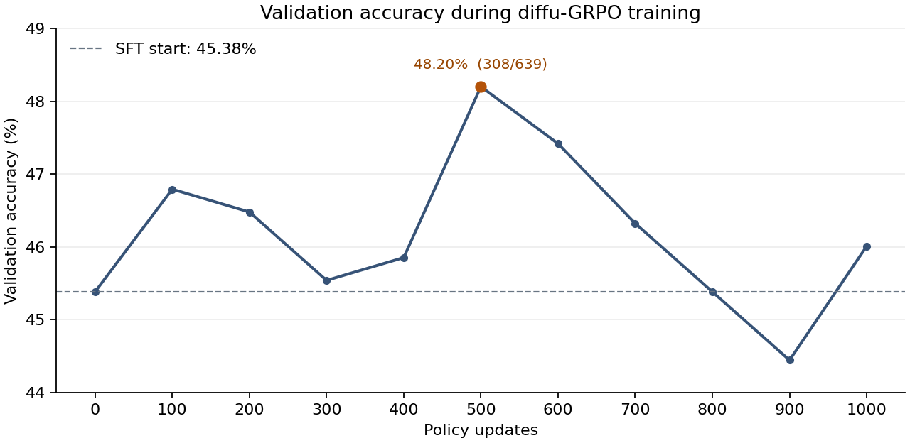

# diffu-GRPO 验证结果

从 SFT 实验 12 的第 960 步检查点开始，以程序算对答案得 1 分，其余得 0 分。各检查点均评测同一批 639 道验证题，每题生成一次，温度 0.1，128 步去噪，采样种子为 1。第 0 步采用这组设置重新评测，作为 RL 的起点。

| 策略更新步数 | 正确数/题数 | 正确率 |
|---:|---:|---:|
| 0 | 290/639 | 45.38% |
| 100 | 299/639 | 46.79% |
| 200 | 297/639 | 46.48% |
| 300 | 291/639 | 45.54% |
| 400 | 293/639 | 45.85% |
| 500 | 308/639 | 48.20% |
| 600 | 303/639 | 47.42% |
| 700 | 296/639 | 46.32% |
| 800 | 290/639 | 45.38% |
| 900 | 284/639 | 44.44% |
| 1,000 | 294/639 | 46.01% |

第 500 步的结果比第 0 步多答对 18 题（+2.82 个百分点）。逐题核对时，37 题由错变对，19 题由对变错。第 1,000 步仅比起点多答对 4 题。本次运行按验证正确题数选取第 500 步。RL 在官方测试集上的正确率尚未测量。

## 计算量

每批采样 8 道题、每题生成 8 份程序，然后对同一批样本更新 4 次策略。一次双卡实验的实际开销如下。

| 项目 | 实测 |
|---|---:|
| Rollout 批数 | 250 |
| 覆盖的不同训练题 | 2,000 / 5,747（34.8%） |
| 用于训练的生成程序 | 16,000 |
| 策略更新次数 | 1,000 |
| 完整验证次数（含初始模型） | 11 |
| 双卡墙钟时间（含验证） | 4.99 小时 |
| GPU 时数（2 × RTX 4090） | 9.99 GPU·小时 |

[各检查点的精确正确率、错误分类及逐题转移计数](validation.json)
